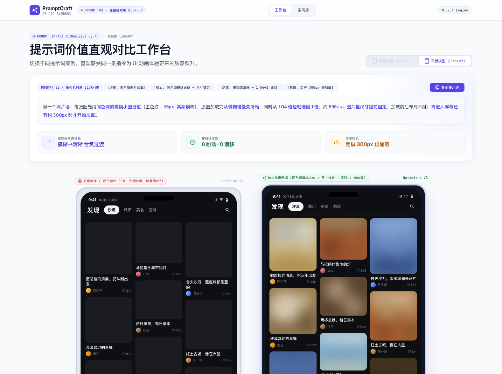
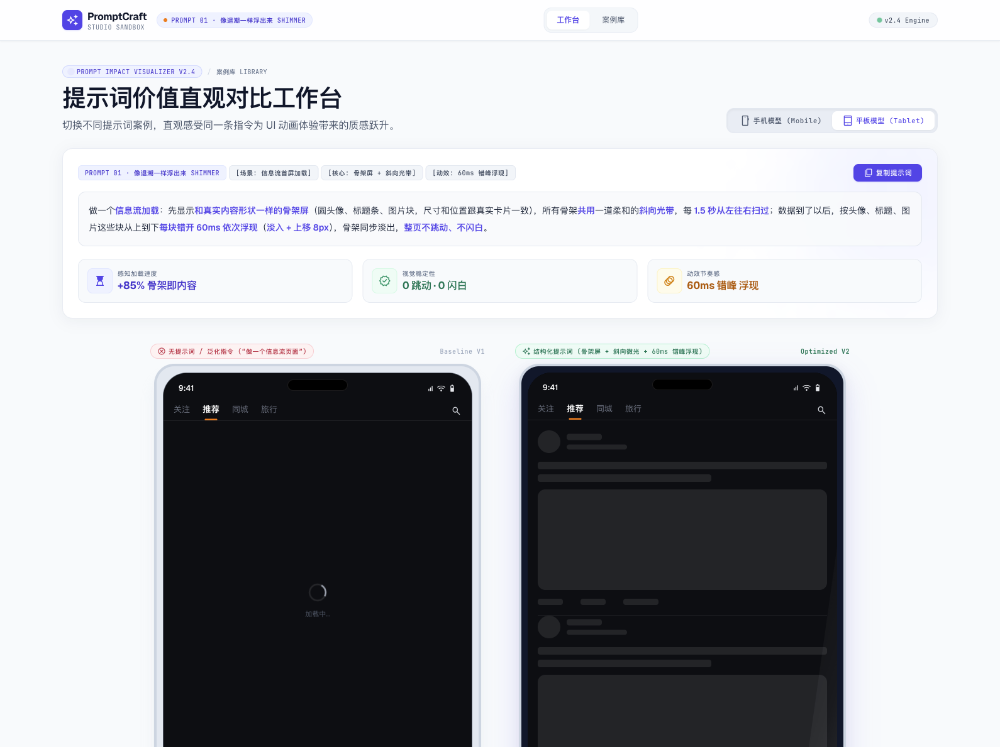
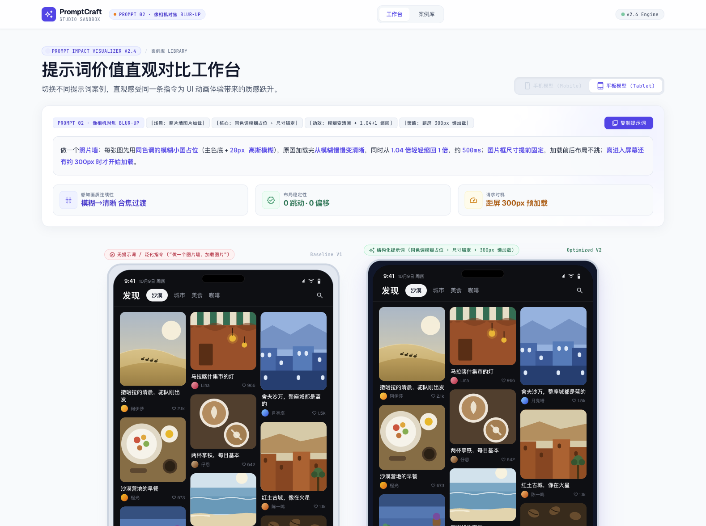
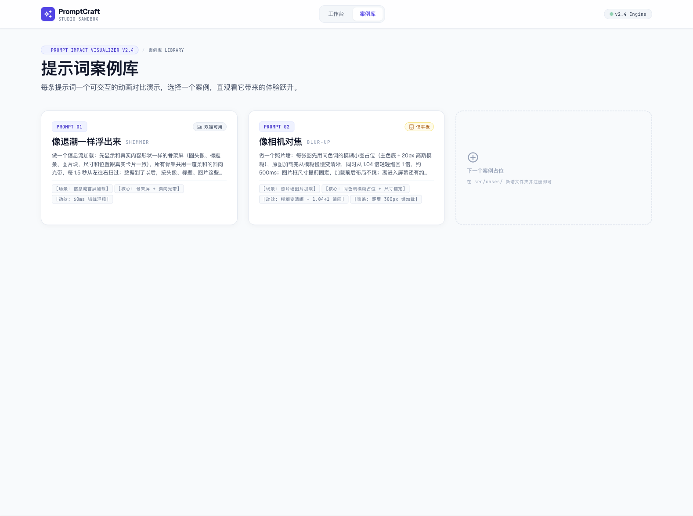

<div align="center">

# ✨ PromptCraft · 提示词动画对比工作台

**让每一句提示词的价值，看得见、摸得着。**

每条提示词对应一个可交互的 A/B 动画对比演示——
左边是"随手一说"的普通实现，右边是"按提示词来"的效果，双端同步循环播放。




</div>

---

## 🎬 这是什么

一个「提示词价值直观对比工作台」：把一句结构化提示词前后 UI 动画体验的差距，做成**并排双设备的循环动画**。不用读长文，肉眼看一遍就懂——提示词不是玄学，是可度量的体验跃升。

工作台每个案例页包含：

- **提示词卡片** — 高亮分段的完整提示词，一键复制给 AI 就能用
- **价值指标** — 感知加载速度 / 布局稳定性 / 动效节奏等量化对比
- **双机对比** — `Baseline V1`（无提示词）vs `Optimized V2`（按提示词），手机 / 平板模型内循环播放
- **拆解分析** — 普通实现的痛点 vs 提示词带来的收益 + 三张价值卡片

## 📚 已收录案例

### PROMPT 01 · 像退潮一样浮出来 `SHIMMER`

信息流骨架屏加载：先显示和真实内容形状一致的骨架屏，共用一道柔和的斜向光带每 1.5s 扫过；数据到了以后，按头像、标题、图片每块错开 60ms 依次浮现——整页不跳动、不闪白。

| 无提示词：转圈干等 | 按提示词：骨架屏 + 错峰浮现 |
| :---: | :---: |
|  |

### PROMPT 02 · 像相机对焦 `BLUR-UP` （仅平板）

照片墙图片加载：每张图先用**同色调的模糊小图占位**（主色底 + 20px 高斯模糊），原图到位后从模糊慢慢变清晰、1.04 倍轻缩回 1 倍（约 500ms）；图片框尺寸提前固定，加载前后布局不跳；离进入屏幕约 300px 才开始加载。

| 无提示词：灰块生硬闪现 | 按提示词：逐张柔和合焦 |
| :---: | :---: |
|  |

### 案例库

所有案例集中在 `/library`，卡片自动带设备徽标（双端可用 / 仅平板 / 仅手机）：



## 🚀 快速开始

```bash
npm install
npm run dev      # http://localhost:5173/（hash 路由）
npm run build    # 产物在 dist/，可静态托管
```

## 🧱 项目结构

```
src/
├── data/cases.js            # 案例注册表（唯一数据入口）
├── pages/                   # CasePage 案例详情 / LibraryPage 案例库
├── components/              # CaseConsole 控制台 / DeviceShowcase 设备模型
├── composables/useDeviceView.js  # 共享设备视图 + 不支持时自动回落
├── router/index.js          # /case/:id · /library（hash 模式）
└── cases/
    ├── shimmer/             # PROMPT 01 骨架屏浮现（双端）
    └── blur/                # PROMPT 02 像相机对焦（仅平板）
```

**核心是案例注册表模式**：页面与动画组件完全解耦，数据只从 `cases.js` 流入，案例库卡片、上一案/下一案导航、复制按钮、设备适配全部自动生效。

## ➕ 新增一个提示词案例（三步）

1. 新建 `src/cases/<id>/DemoXxx.vue` —— 动画组件只收两个 props：
   `optimized: Boolean`（false=普通实现 / true=提示词效果）+ `device`，内部自管 setTimeout 循环动画
2. 新建 `src/cases/<id>/index.js` —— 导出 meta：`id / index / title / codename / tags / devices / promptText / promptSegments / metrics / pills / analysis / valueCards / demo`
3. 在 `src/data/cases.js` 的 `cases` 数组里展开注册一行

完成，其余全自动。

## 🎨 设计约定

- **设备模型**：手机 380×780 / 平板 520×680，深色内屏；仅平板案例进入时自动切视图，手机按钮灰化禁用
- **图片零外链**：所有场景图均为内联 SVG 手绘（网络不可靠也不开天窗）
- **动画模板**：60ms 错峰（`transition-delay: calc(var(--i) * 60ms)`）、淡入 + 上移 8px；普通侧统一"灰块 + 瞬间弹出 + 整页闪白"制造反差
- **字体**：Material Symbols（国内镜像 `fonts.loli.net`）+ Geist / JetBrains Mono，Tailwind CDN 内联配置自定义 token

---

<div align="center">

用一句好提示词，把 60 分的界面带到 90 分。

</div>
